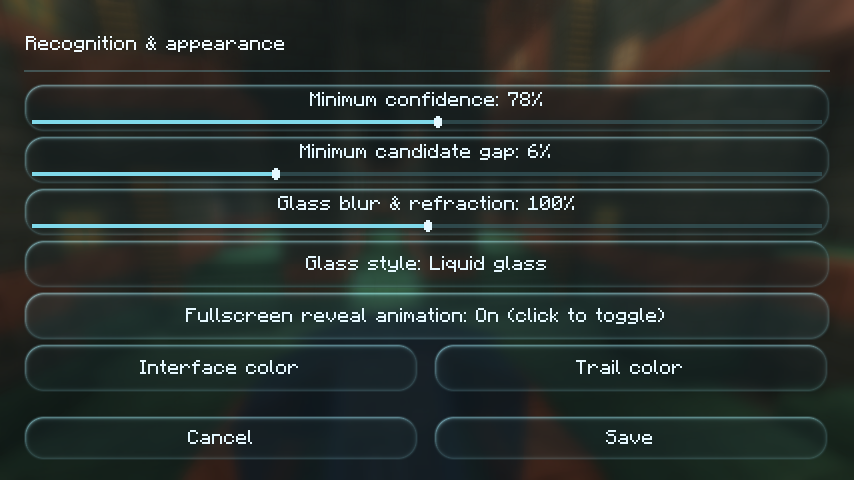
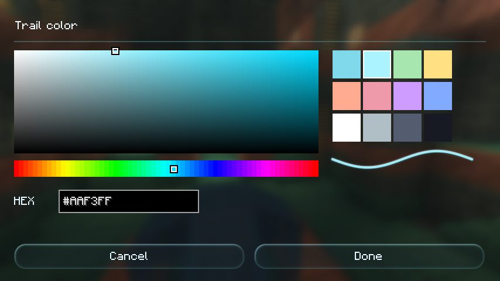
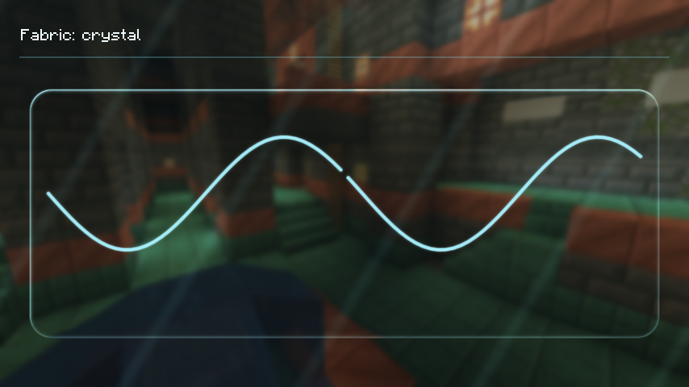
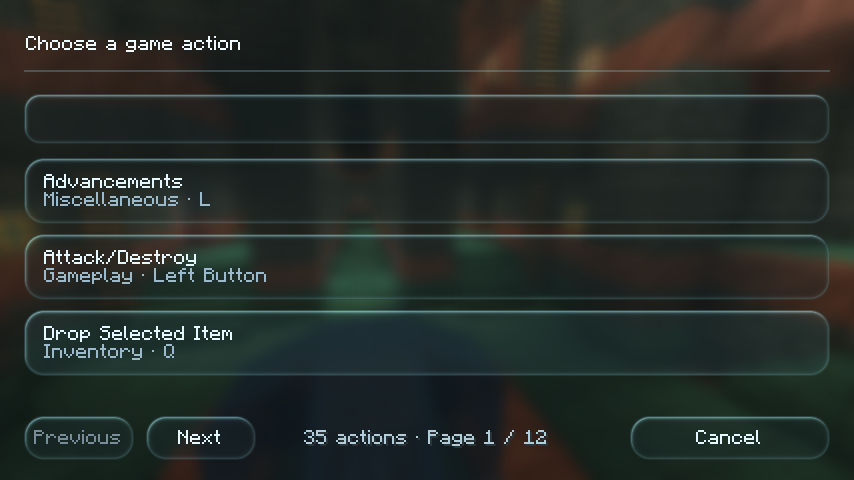
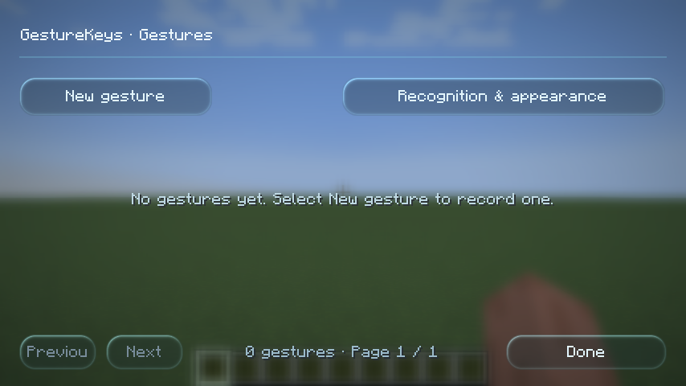

# Fabric 1.21.1 verification / 验证记录

Date / 日期：2026-10-27

| Component / 项目 | Verified environment / 验证环境 |
| --- | --- |
| Minecraft | 1.21.1 |
| Fabric Loader | 0.16.14 |
| Fabric API | 0.116.17+1.21.1 |
| Mod Menu | 11.0.3 |
| Java | GraalVM JDK 21.0.11 |
| OS / 系统 | Windows |
| GPU | NVIDIA GeForce RTX 4060 Laptop GPU |
| Build / 构建 | Fabric Loom 1.14.10, Gradle Wrapper 9.2.1, Mojang mappings |

## Results / 结果

The Fabric client launched successfully and completed **28 runtime checks**. The development
harness opened real screens, rendered frames, reloaded resources, and entered a fresh flat
single-player world. The checks use Minecraft and mod APIs; they do not simulate physical Alt
input. Unit tests were not run for this port.

Fabric 客户端实际启动成功，完成 **28 项运行检查**。开发检查程序打开真实界面、渲染画面、
重载资源，并进入新建的超平坦单人世界。检查通过游戏和模组 API 驱动，未模拟真实硬件 Alt 输入；
此次移植未运行单元测试。

- Client entry point, activation-key registration and binding lookup.
  客户端入口、激活键注册与绑定读取。
- Settings, appearance, color picker, action picker wheel handler, and Mod Menu settings factory.
  设置、外观、调色盘、动作选择滚轮处理与 Mod Menu 设置入口。
- Nine glass styles plus Off, antialiased trail shaders, OpenGL state, and resource reload.
  九种玻璃风格及关闭、抗锯齿轨迹 Shader、OpenGL 状态与资源重载。
- In-world inventory action, timed jump hold, synthetic key-state mixin, and release on opening a screen.
  世界内背包动作、定时跳跃长按、模拟按键状态 Mixin 与打开界面时释放。
- Local Fabric client command opens settings through the action executor.
  通过动作执行器调用 Fabric 本地客户端指令并打开设置。

Raw evidence / 原始记录：[28 checks](fabric/checks.txt) · [environment](fabric/environment.txt).

## Captures / 实际截图

Captured at 854 × 480, GUI scale 2. The palette, crystal trail, preferences, and action-page footer
were visually inspected. The gap in the crystal trail intentionally represents a pen lift.

截图分辨率 854 × 480、GUI 缩放 2。已目视检查调色盘、水晶轨迹、外观滑条和动作页脚；
水晶轨迹中央的间隙用于检查抬笔后的分段。











## Reproduce / 复现

Use Java 21 and the project wrapper / 使用 Java 21 和项目 Wrapper：

```powershell
.\gradlew.bat -PlaunchCheck runClient
.\gradlew.bat clean assemble -x test
```

The launch check uses the isolated run-fabric-check directory. Evidence is written to
build/fabric-launch-check. Archive it before clean. A FAILED.txt file means the check failed,
even if Gradle exits successfully. Regular builds exclude the development checker; the old
NeoForge src/smoke harness is also excluded.

启动检查使用独立的 run-fabric-check 目录，输出位于 build/fabric-launch-check；执行 clean
前应保存记录。若存在 FAILED.txt，即使 Gradle 返回成功，也应判定检查失败。普通构建不包含
开发检查代码；原 NeoForge 的 src/smoke 检查代码同样不参与 Fabric 构建。

## Scope / 验证边界

Physical Alt release, OS focus changes, multiplayer, and third-party rendering mods still require
manual regression in the intended instance. Mod Menu was installed during this run. The wheel
handler was invoked; a complete pagination boundary regression was not repeated. Style and
palette frames render correctly; the full prior save/cancel and live-drag regression was not
repeated. No Fabric performance benchmark was collected. Historical NeoForge measurements
in [verification.md](verification.md) do not establish Fabric timing or compatibility.

真实 Alt 松开、操作系统切换焦点、多人环境及第三方渲染模组仍需在目标实例中手动回归。
此次启动安装了 Mod Menu。已调用滚轮处理，但未重复完整分页边界回归。风格与调色盘画面正常，
未重复此前完整的保存/取消和实时拖动回归。未采集 Fabric 性能基准；
[verification.md](verification.md) 中的历史 NeoForge 数据不代表 Fabric 性能或兼容性。
