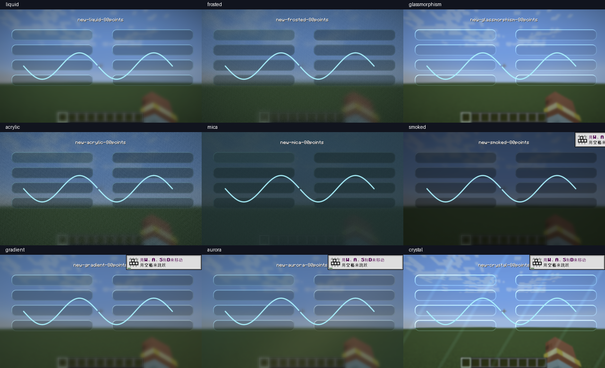
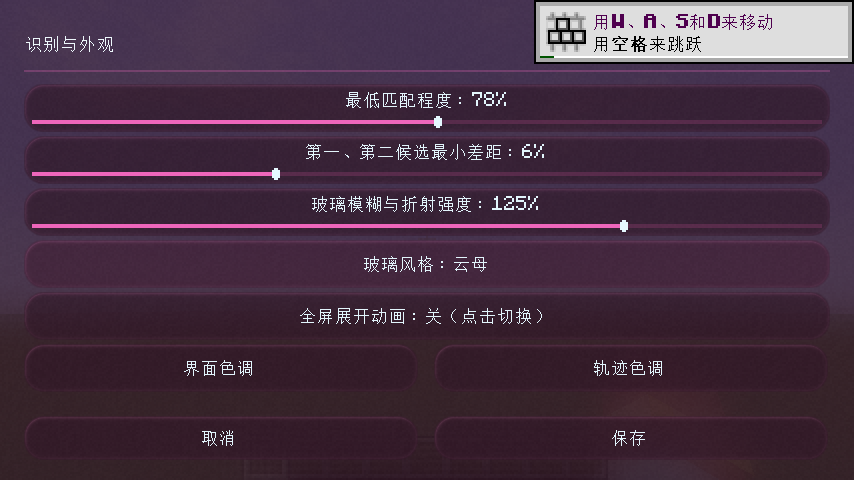
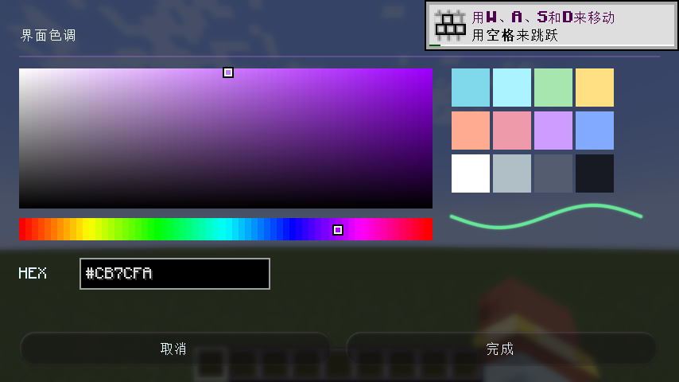
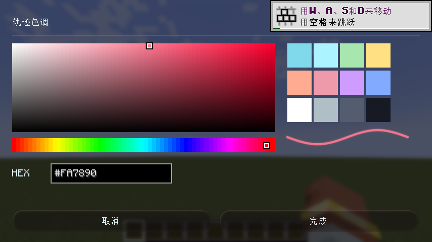
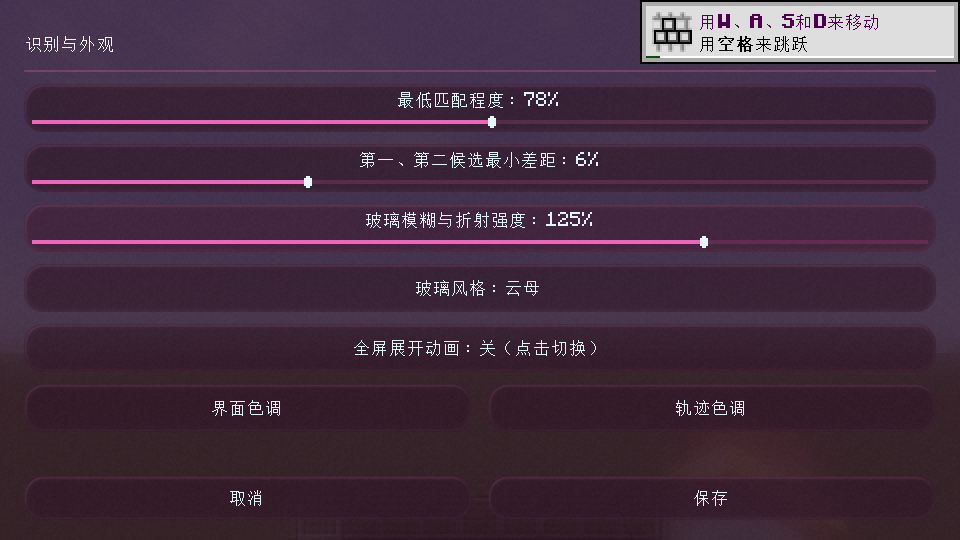
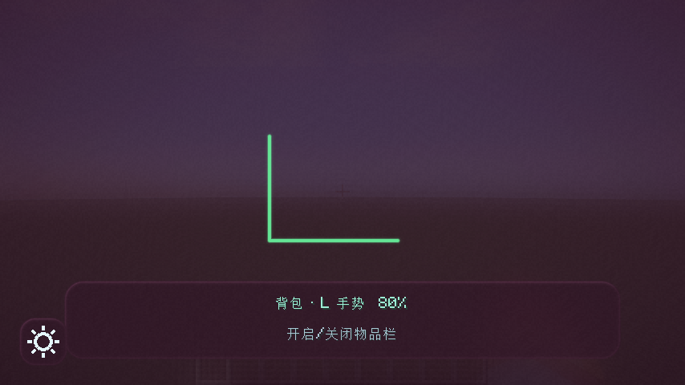

# 验证记录

> 后续变更说明：滚轮分页、总页数显示与 Apache-2.0 授权更新未执行测试；下述记录来自此前功能版本。

日期：2026-10-27。当前复核环境：Windows、Java 21.0.11、Minecraft 1.21.1、NeoForge 21.1.172、RTX 4060 Laptop / OpenGL 4.6。

Maven 连接超时期间通过临时 Gradle init 脚本使用本地缓存的 NeoForm Runtime 2.0.24 离线构建；NeoForge 编译、运行和最低要求均为 21.1.172，项目未永久修改构建工具版本。

## 检查结果

- 普通 clean build：26 项单元测试，零失败。
- 原有客户端回归：32 项通过，包括识别滑条、保存/取消、成功静默、未识别/冲突提示、动作释放和资源重载。
- 外观客户端检查：61 项通过，包括九种风格与关闭、强度/风格/颜色下一帧生效、HSV 拖动、HEX、无效输入、草稿隔离、磁盘重载、紧凑 GUI、Shader 失败降级和 OpenGL 无错误。
- 单元测试额外覆盖旧 Shader 开关迁移、未知风格与异常颜色、风格/颜色持久化、RGB/HSV 转换、端点/锐角/抬笔间隙及原始识别坐标不变。

检查通过客户端内部输入和界面 API 驱动。实际帧截图已检查轨迹连续性、抬笔间隙、颗粒效果、半分辨率采样、调色盘和紧凑布局。

原始记录：[客户端回归](client-checks.txt)、[外观检查](visual-checks.txt)、[1080p 性能 CSV](timing-1080p.csv)、[854×480 性能 CSV](timing.csv)。

## 性能

同一开发客户端、同一场景；绘制八个面板和一条轨迹，比较更新前渲染器与新渲染器。每种模式预热 35 帧后采样 80 帧，GPU 使用异步 GL_TIME_ELAPSED 查询。下面为 1920×1080 结果，单位 ms。

| 模式 | CPU 中位 | GPU 中位 | GPU P95 |
| --- | ---: | ---: | ---: |
| 原液态玻璃，80 点 | 0.3938 | 0.5898 | 1.1397 |
| 新液态玻璃，80 点 | 0.3424 | 0.2755 | 0.7332 |
| 磨砂玻璃，80 点 | 0.2977 | 0.2478 | 0.8632 |
| 玻璃拟态，80 点 | 0.2985 | 0.2632 | 0.9267 |
| 亚克力，80 点 | 0.3099 | 0.2744 | 0.9370 |
| 云母，80 点 | 0.2956 | 0.2877 | 0.8018 |
| 烟熏玻璃，80 点 | 0.2922 | 0.3031 | 1.0076 |
| 渐变玻璃，80 点 | 0.2991 | 0.3215 | 1.0281 |
| 极光玻璃，80 点 | 0.2900 | 0.3338 | 1.1244 |
| 水晶玻璃，80 点 | 0.2925 | 0.3482 | 1.0742 |
| 关闭玻璃 Shader，80 点 | 0.7402 | 0.2345 | 1.1162 |
| 原液态玻璃，4096 点 | 7.6534 | 24.5432 | 29.0703 |
| 新液态玻璃，4096 点 | 1.8071 | 0.5560 | 1.1776 |

这测量的是模组绘制范围，不含世界渲染和完整游戏帧耗时，也不构成其他机器的 FPS 保证。关闭玻璃 Shader 时圆角控件采用 CPU 几何绘制，CPU 时间不一定更低。半分辨率双通道模糊、轨迹覆盖合批与局部合成降低了该场景的开销；颜色和风格切换复用已有渲染目标。

## 界面截图

九种玻璃风格，按行依次为液态/磨砂/玻璃拟态、亚克力/云母/烟熏、渐变/极光/水晶。

## 验证边界

真实硬件 Alt、操作系统切出/切入、多人服务器，以及其他显卡和第三方渲染模组组合，未进行完整手工回归。之前的 15 项客户端检查曾在 NeoForge 21.1.264 / RTX 3070 上完成；本页当前的新增外观与性能结果均来自 21.1.172 / RTX 4060 Laptop。
