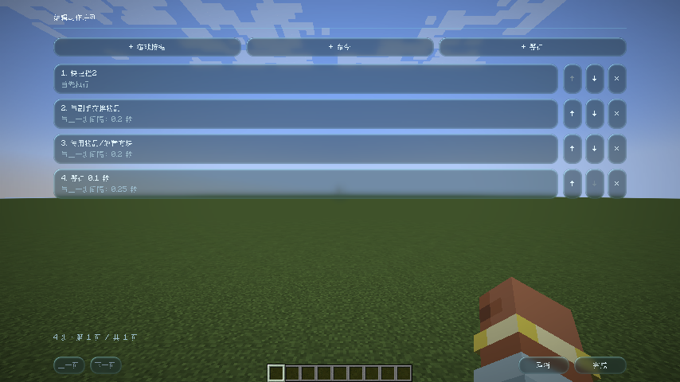
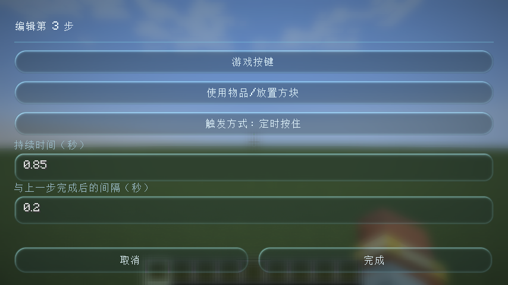
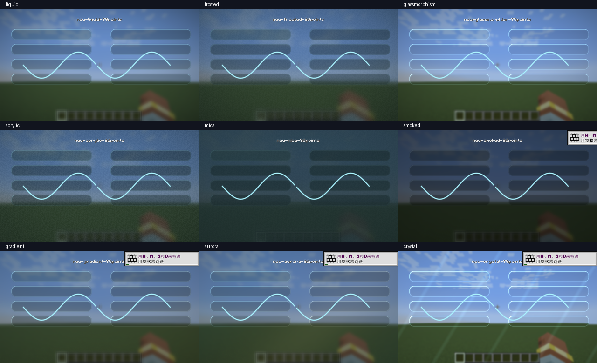
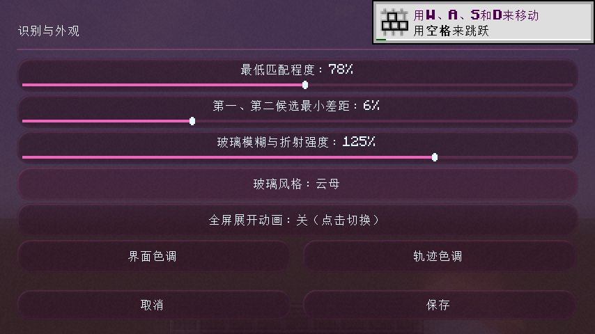
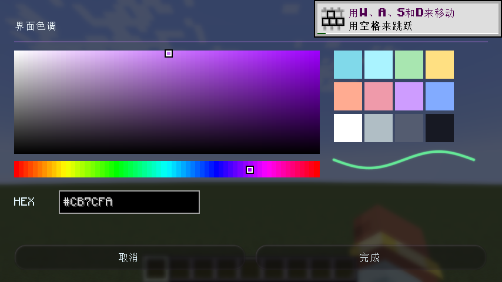
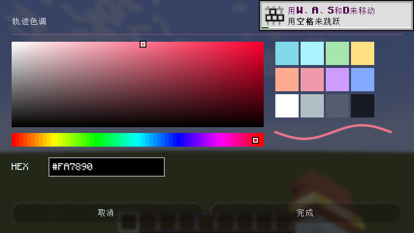
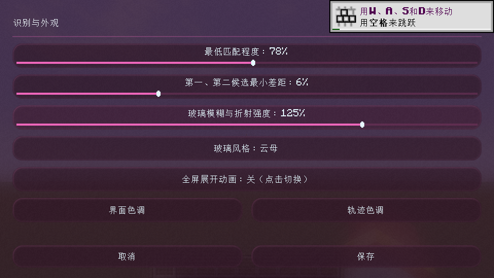
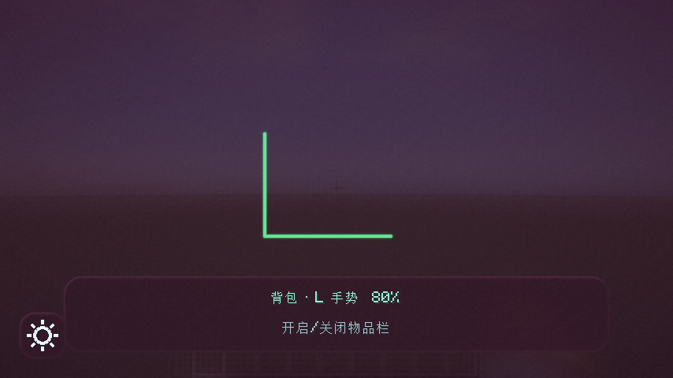

# 验证记录

## 2026-11-01 版本 1.2.0 与 Fabric 同步

- 两端版本号、包内元数据、安装文档和双语变更日志统一为 **1.2.0**。
- NeoForge 保留当前动作序列、命令路由和输入兼容修复，34 项单元测试与普通构建通过；功能客户端结果见下方 94 项检查。
- Fabric 分支同步序列配置、逐刻执行器、编辑界面、三种语言、旧配置兼容与命令自动路由，保留 Fabric 原生按键/命令 API 和 Mod Menu。
- Fabric：34 项单元测试与普通构建通过；1.2.0 开发客户端 88 项检查通过，覆盖真实副手序列、取消/替换、输入兼容、`/help`、`/msg @s 111`、未公开的服务端命令、本地同名优先和服务器异步失败后继续。
- Fabric 没有 NeoForge 修饰键扩展；两端未升级 Minecraft 或加载器依赖。当前推送范围仅代码、测试和文档，不包含发布标签或 GitHub Release。

## 2026-11-01 客户端与服务器命令路由修复

原实现只查询 NeoForge 本地客户端调度器，导致原版服务器命令 `/help` 和 `/msg @s 111` 在序列预检查时被拒绝。
现在本地已注册的命令按根名称优先在本地检查、执行，其余通过原版 `ClientPacketListener.sendCommand` 发送，以保留消息参数签名与聊天确认机制。
服务器命令只检查非空和连接可用；不依赖可能不完整的服务端命令树，也不在本地执行服务端树中的占位处理器。

- Minecraft 1.21.1 / NeoForge 21.1.172 / Java 21.0.11，独立开发客户端与内置服务器。
- 94 项客户端检查通过，其中保留此前 77 项界面、按键和序列检查，新增 17 项命令路由检查。
- 真实序列发送 `/help`、`/msg @s 111`，从服务端 CommandEvent 确认原始文本到达，并检查客户端聊天栏中的帮助与私聊反馈；没有直接调用服务端命令执行器代替发送命令。
- 客户端与服务端注册同名测试命令，确认客户端优先且服务端未执行。
- 服务端注册、但没有向客户端公开的测试命令仍能正常到达并执行。
- 本地命令参数错误仍在预检查阶段拒绝；本地命令失败与命令打开界面时仍取消剩余步骤。
- 服务端返回失败或未知命令反馈时，聊天栏正常显示错误，后续步骤继续。
- 普通构建与 34 项单元测试通过；英文、简体中文、繁体中文提示均已更新。

复现：

```powershell
.\gradlew.bat runClient -Psmoke -PsmokeDir=build/command-routing-smoke-run --offline
.\gradlew.bat clean build --offline
```

原始结果：[94 项客户端检查](command-routing-checks.txt)、[客户端日志](command-routing-client.log)。
`/msg @s 111` 在允许选择器的测试环境执行；服务器权限与正常聊天栏一致。未测试第三方多人服务器的插件组合或在线账号的安全聊天策略；发送使用原版接口。

## 2026-11-01 动作序列

- Minecraft 1.21.1 / NeoForge 21.1.172 / Java 21.0.11；仅修改 NeoForge 分支。
- 普通构建与 34 项单元测试通过，覆盖旧配置、序列深复制与持久化、逐刻排序、按住完成后的间隔、显式等待、取消与替换、无效步骤和时间边界。
- 开发客户端 77 项检查全部通过，包含既有界面与输入兼容回归，以及序列编辑、草稿保存/取消、增删排序、0.05 秒精度、紧凑 GUI、整段预检查、命令执行失败、界面/失焦中断和模拟点击清理。
- 验收流程通过真实 KeyMapping 输入逐刻完成：快捷栏第 2 格 → 交换副手物品 → 使用物品。以主手木棍、副手望远镜验证原版副手使用行为，内置服务端同时确认选中槽位与物品交换结果。
- 命令打开设置界面、游戏按键打开背包均立即取消剩余步骤；关闭界面不会恢复执行。新序列替换旧序列时先释放旧按键，旧尾部步骤不执行。
- 验证了已有物理点击、交错的物理/模拟点击与原版清空点击队列后的取消；不留下未消费的模拟点击，也不移除已跟踪的物理点击。
- 实际游戏截图检查了序列列表、按住与间隔编辑，以及 854×480 / GUI 缩放 2 的紧凑布局。

复现（独立目录，不加载 `run-smoke/mods` 中的第三方模组）：

```powershell
.\gradlew.bat test build --offline
.\gradlew.bat runClient -Psmoke -PsmokeDir=build/sequence-smoke-run --offline
```

检查 `build/smoke/checks.txt` 的 PASS 项及 `FAILED.txt` 是否存在；客户端自行退出不代表所有断言通过。
原始结果：[77 项客户端检查](sequence-checks.txt)、[客户端日志](sequence-client.log)。





本轮使用独立客户端与内置服务端，未重新测试 Mekanism、真实硬件输入、多人服务器或高延迟网络；默认间隔不能保证网络同步已经完成。
物品使用沿用原版主副手优先级。日志中的开发账号资料/公钥请求超时没有阻止单机测试，没有序列或 Mixin 错误。

## 2026-10-31 版本 1.1.0

- NeoForge 与 Fabric 的 `mod_version`、包内元数据和安装文档统一为 1.1.0，Minecraft 版本保持 1.21.1。
- NeoForge：默认 21.1.172 普通构建与 26 项单元测试通过；21.1.234 + Mekanism 10.7.19.85 客户端再次完成 57 项检查。
- Fabric：在 `fabric-1.21.1` 分支同步目标按键的按下/释放、时限、物理按键重叠、扫描码和原版切换键修复；
  Fabric Loader 0.16.14 / Fabric API 0.116.17+1.21.1 普通构建与 26 项单元测试通过，客户端 45 项检查通过。
- Fabric 保留专属客户端命令与注册方式。Fabric 没有 NeoForge 的 `KeyModifier` API，不包含其专用扩展 Mixin；
  自行检查组合键或原始输入的模组仍可能需要单独适配。NeoForge 版 Mekanism 未用于 Fabric 验证。

原始结果：[NeoForge 57 项](input-compatibility-checks.txt)、[Fabric 45 项](fabric-input-1.1.0-checks.txt)。

## 2026-10-30 按键兼容修复

GestureKeys 现在向选定的 `KeyMapping` 实例派发按下与释放，兼容通过覆写 `setDown` / `isDown` 实现的动作。
手势执行期间只豁免目标映射的组合修饰键要求，保留其冲突上下文；不改变保存的键位、物理修饰键或玩家下蹲状态。

- 普通构建与单元测试：Minecraft 1.21.1 / NeoForge 21.1.172，26 项单元测试通过。
- 客户端回归：Minecraft 1.21.1 / NeoForge 21.1.234 / 用户提供的 Mekanism 10.7.19.85，57 项检查全部通过。
- 新增检查覆盖未绑定实体键的 Ctrl/Shift 动作、绕过父类 `isDown` 的子类回调、单击/定时释放、重复触发、同键隔离、物理释放与虚拟按住重叠、扫描码物理状态、失焦释放，以及原版切换键行为。
- Mekanism 使用喷气背包与自由奔跑靴验证：通过动作执行器触发真实模式切换包，服务端模式依次为 `NORMAL → HOVER → VECTOR` 和 `NORMAL → SAFETY → DISABLED`；首次变化同步回客户端。测试没有直接调用模式切换 API。
- 测试中将胸甲映射设为 Ctrl + 未绑定、脚部映射设为 Shift + 未绑定，执行时无需按住实体修饰键。

原始检查结果：[按键兼容回归](input-compatibility-checks.txt)。

复现：将 Mekanism JAR 放入独立测试目录 `run-smoke/mods`，运行：

```powershell
.\gradlew.bat -Psmoke '-Pneo_version=21.1.234' runClient
```

不放入 Mekanism 时会跳过该模组的专属检查，仍执行通用按键回归。
测试程序恢复创造背包的客户端菜单状态后再验证装备同步，避免 UI 检查残留菜单导致槽位更新被错误应用。

本次 21.1.233 的 Maven 依赖下载超时，因此实际运行采用本机缓存的 21.1.234；未改动工程的默认版本或最低版本要求，未修改用户游戏实例。
直接轮询 GLFW 或原始键盘事件的其他模组仍需单独适配；本次未重新执行外观性能基准和真实硬件输入回归。

## 2026-10-27 外观与既有功能

> 后续变更说明：滚轮分页、总页数显示与 Apache-2.0 授权更新未执行测试；下述记录来自此前功能版本。

日期：2026-10-27。当前复核环境：Windows、Java 21.0.11、Minecraft 1.21.1、NeoForge 21.1.172、RTX 4060 Laptop / OpenGL 4.6。

Maven 连接超时期间通过临时 Gradle init 脚本使用本地缓存的 NeoForm Runtime 2.0.24 离线构建；NeoForge 编译、运行和最低要求均为 21.1.172，项目未永久修改构建工具版本。

## 检查结果

- 普通 clean build：26 项单元测试，零失败。
- 原有客户端回归：32 项通过，包括识别滑条、保存/取消、成功静默、未识别/冲突提示、动作释放和资源重载。
- 外观客户端检查：61 项通过，包括九种风格与关闭、强度/风格/颜色下一帧生效、HSV 拖动、HEX、无效输入、草稿隔离、磁盘重载、紧凑 GUI、Shader 失败降级和 OpenGL 无错误。
- 单元测试额外覆盖旧 Shader 开关迁移、未知风格与异常颜色、风格/颜色持久化、RGB/HSV 转换、端点/锐角/抬笔间隙及原始识别坐标不变。

检查通过客户端内部输入和界面 API 驱动。实际帧截图已检查轨迹连续性、抬笔间隙、颗粒效果、半分辨率采样、调色盘和紧凑布局。

原始记录：[客户端回归](client-checks.txt)、[外观检查](visual-checks.txt)、[1080p 性能 CSV](timing-1080p.csv)、[854×480 性能 CSV](timing.csv)。

## 性能

同一开发客户端、同一场景；绘制八个面板和一条轨迹，比较更新前渲染器与新渲染器。每种模式预热 35 帧后采样 80 帧，GPU 使用异步 GL_TIME_ELAPSED 查询。下面为 1920×1080 结果，单位 ms。

| 模式 | CPU 中位 | GPU 中位 | GPU P95 |
| --- | ---: | ---: | ---: |
| 原液态玻璃，80 点 | 0.3938 | 0.5898 | 1.1397 |
| 新液态玻璃，80 点 | 0.3424 | 0.2755 | 0.7332 |
| 磨砂玻璃，80 点 | 0.2977 | 0.2478 | 0.8632 |
| 玻璃拟态，80 点 | 0.2985 | 0.2632 | 0.9267 |
| 亚克力，80 点 | 0.3099 | 0.2744 | 0.9370 |
| 云母，80 点 | 0.2956 | 0.2877 | 0.8018 |
| 烟熏玻璃，80 点 | 0.2922 | 0.3031 | 1.0076 |
| 渐变玻璃，80 点 | 0.2991 | 0.3215 | 1.0281 |
| 极光玻璃，80 点 | 0.2900 | 0.3338 | 1.1244 |
| 水晶玻璃，80 点 | 0.2925 | 0.3482 | 1.0742 |
| 关闭玻璃 Shader，80 点 | 0.7402 | 0.2345 | 1.1162 |
| 原液态玻璃，4096 点 | 7.6534 | 24.5432 | 29.0703 |
| 新液态玻璃，4096 点 | 1.8071 | 0.5560 | 1.1776 |

这测量的是模组绘制范围，不含世界渲染和完整游戏帧耗时，也不构成其他机器的 FPS 保证。关闭玻璃 Shader 时圆角控件采用 CPU 几何绘制，CPU 时间不一定更低。半分辨率双通道模糊、轨迹覆盖合批与局部合成降低了该场景的开销；颜色和风格切换复用已有渲染目标。

## 界面截图

九种玻璃风格，按行依次为液态/磨砂/玻璃拟态、亚克力/云母/烟熏、渐变/极光/水晶。













## 验证边界

真实硬件 Alt、操作系统切出/切入、多人服务器，以及其他显卡和第三方渲染模组组合，未进行完整手工回归。之前的 15 项客户端检查曾在 NeoForge 21.1.264 / RTX 3070 上完成；本页当前的新增外观与性能结果均来自 21.1.172 / RTX 4060 Laptop。
